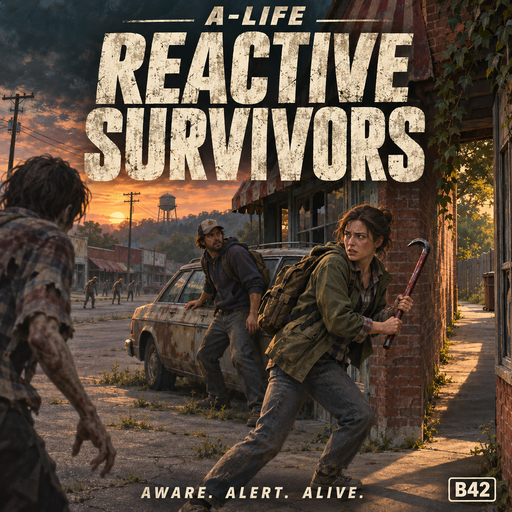

# A-Life: Reactive Survivors [B42]

Free and open source. The code is written by an AI; the direction, the testing and the time are mine. If the mod made your game better: [support on Boosty](https://boosty.to/lrgpp).

An add-on for [Project A-Life [ALIFE NPCS]](https://steamcommunity.com/sharedfiles/filedetails/?id=3803984183) (by Vice):
NPCs react to the world sooner. They attack a zombie before it bites, run from a group toward their friends, dodge
vehicles, and say what they do (English and Russian). Project A-Life itself is not changed and none of its code is
copied; this is a separate Lua mod that adjusts A-Life through its public tables and functions.

> **0.4.0 — awareness before contact.** Idle/recovering NPCs react to visible approaching zombies; armed survivors can engage, while unarmed/tired survivors choose a short checked escape. Fixed A-Life cancelling the newly created reaction action. [Verification and limits](docs/TEST_0.4.0.md).

**Steam Workshop:** https://steamcommunity.com/sharedfiles/filedetails/?id=3829332775 · **Source code (MIT):** https://github.com/druidqwerty/ALifeReactiveSurvivors

Русская версия: [README_RU.md](README_RU.md)

## The problem

A zombie walks 7-10 tiles straight at an A-Life NPC. The NPC watches it, does not draw a weapon, and then stands
still while it gets bitten. Reading A-Life 1.4.6 shows why:

- a travelling or idle NPC "bypasses" a zombie until it is within 1.5 tiles (contact), so the zombie bites first;
- at contact the weapon draw takes about 1.2 s and a one-handed swing cycle about 1.5 s;
- after one retreat the NPC avoids that zombie for 25 s, and after a failed approach it ignores it for 10-15 s.

And nothing in A-Life looks at vehicles: a survivor on the road stands there until the car hits it.

## What the add-on does

Every situation is a ladder: the first rung that fits decides; whatever the add-on does not touch stays A-Life's.

**A lone zombie**

Within the existing reaction radius (default 6 tiles), a visible closing/targeting zombie can alert an idle NPC before contact. A ready armed NPC asks A-Life to engage. Unarmed, tired or avoiding NPCs can take a checked short step up to 3 tiles away instead. A tighter arrival radius keeps short fallback steps from completing almost in place. A blocked escape is refused. Existing conversations, orders, guard leashes, passengers and gun fear retain priority; busy NPCs are not made to wander randomly.

**A group of zombies** (idea from the Steam comments)
1. Three or more zombies within 6 tiles: no early attack. A-Life decides at contact and withdraws when outnumbered,
   as before.
2. Three or more within 6 tiles and at least two walking at the NPC: it evaluates up to 11 short escape routes,
   normally up to 8 tiles long. It avoids known zombies along the route and at the destination, blocked/fenced
   crossings, fire, campfires, water, missing floor and unloaded squares, including unsafe diagonal corners.
3. A same-side NPC or friendly player within 20 tiles can influence the destination, but cannot override safety.
   Routes stay outdoors or within the current building. If no route is validated, ALR does not force movement;
   the original A-Life decision continues. Nearby zombies are heard; farther ones must be visible.
4. At most three such runs a minute. Guards on a leash, NPCs with orders and NPCs holding a post never leave it.

**A vehicle** (heard; no sight check)
1. A slow vehicle (under 12 km/h) coming at an idle NPC within 5 tiles: the NPC steps 2 tiles aside ("Go ahead.").
2. A vehicle faster than 12 km/h whose path passes within 2 tiles of the NPC in the next 2.2 seconds: the NPC
   sprints 3 tiles sideways, away from the path ("Watch it!").
3. Faster than 25 km/h and less than a second away: a 4.5-tile dive ("Look out!"). A player who did it is remembered.
4. Hit anyway: a moment after A-Life's own cry of pain, "Argh! You hit me!"; the same player twice within two
   minutes: "Do that again and we have a problem."

NPCs inside buildings, inside vehicles or in a fight do not dodge.

**Bitten**: "Get off me!" a second after the bite.

**Fights faster, gets stuck less** (since 0.1.0): weapon draw 20 % shorter; shorter swing preparation, windup,
recovery and pause between swings; avoids a zombie 8 s after a retreat instead of 25 s; ignores it at most 4 s after
a failed approach; looks for threats more often; back to the fight at endurance 50 instead of 72. Works with the Jeem
Extension (its zombie-focus filter gets the same numbers).

All lines exist in English and Russian; an NPC speaks the language of the game that runs it. Zombies are not changed.
In multiplayer the add-on runs where A-Life runs the NPC (on the players' games), so every player needs it.

## Requirements and installation

- [ZombieBuddy](https://steamcommunity.com/sharedfiles/filedetails/?id=3619862853) must be installed as required by A-Life. [Jeem Extension](https://steamcommunity.com/sharedfiles/filedetails/?id=3806944055) is optional, but recommended for the full experience; its tuning integration is not a hard mod.info dependency.
- Project Zomboid Build 42 (42.20+), [Project A-Life [ALIFE NPCS]](https://steamcommunity.com/sharedfiles/filedetails/?id=3803984183).
- Subscribe on the [Steam Workshop](https://steamcommunity.com/sharedfiles/filedetails/?id=3829332775) and enable
  "A-Life: Reactive Survivors" after Project A-Life. On a server add `ALifeReactiveSurvivors` to `Mods=` (after
  `ProjectALifeNPCs`) and `3829332775` to `WorkshopItems=`; every player needs the mod.
- Or without Steam: unpack the zip from [Releases](https://github.com/druidqwerty/ALifeReactiveSurvivors/releases) to
  `%USERPROFILE%\Zomboid\mods\` so that you get `mods\ALifeReactiveSurvivors\42\mod.info`.

## Settings

All 66 settings are global world/server Sandbox options on **A-Life: Reactive Survivors**. Set them when hosting;
an admin can change the running world's Sandbox options. Changes apply within two seconds without a restart.
They are not duplicated in personal ModOptions. Old saves receive the defaults for missing options.
**Safe crowd retreat** is on by default; switching it off restores the older geometric retreat. The master toggle
can disable/re-enable the add-on live, including restoring tuning values that ALR still owns.

## Is it working?

- `console.txt` shows `[ALR] v0.4.0 installed`.
- Every minute (when something changed): `[ALR] checks=.. commits=.. dodges=.. dives=.. fallbacks=.. regroups=..
  bites=.. hits=.. lines=..`. `commits` grows when an NPC attacked a zombie earlier than A-Life would have,
  `dodges` / `dives` when it jumped out of a car's way, `fallbacks` / `regroups` when it ran from a group.
- Lua console: `ALifeReactive.status()` prints the counters and every changed value (was -> now).

## Known limitations

- Local retreat only, not a global navigator or guaranteed escape. Search work is bounded; exhausted budgets leave
  the original A-Life decision in control. Crowd thresholds, combat decisions, guard posts and orders are unchanged.
- The new planner does not alter vehicle-dodge paths or add combat-state dodging. Multiplayer ownership handoffs
  and long sessions with large mod packs still need broader coverage; simulation is not a substitute for that.
- Vehicles are not dodged while the NPC is fighting, and only vehicles on the NPC's floor count.
- Multiplayer: a zombie's bite can be computed on another player's game than the one running the NPC, so the NPC may
  not learn that it is being bitten. Planned for a later version.
- Bite stagger (0.5 s) and the zombies' own behaviour are untouched.
- The add-on cannot react for an A-Life NPC whose physical replica never arrives on the owning client.
  One post-death test fixture hit upstream `replica_missing`/body-recovery failures; this release does not fix that replication subsystem.

## How it works (for modders)

A-Life decides what to do about a zombie in a public function, `ProjectALife.DecisionLoop.engagement`. The add-on
wraps it and turns the verdict "bypass / continue_mission" into "commit" when the zombie is close and coming (the
verdict "defend" is not used on purpose: a defend-on-travel combat state ends at the next tick as soon as the zombie
is more than 1.5 tiles away). Retreat leases, ignore timers and the weapon-draw durations are capped by wrapping
three more public functions. The timings live in A-Life's public settings tables (`BehaviorSettings`,
`Combat.settings`, `Endurance.settings`, the decision-loop lanes, ZombieFocus, Fear, Caution); the add-on writes its
numbers there and again after `DecisionLoop.configure`, which rebuilds them at game start.

The group and vehicle ladders hang on `ModuleGunFear.interrupt`, the hook the decision loop calls on every think of
an idle, walking, scavenging or recovering NPC with its own `startMovement` / `startRetreat` helpers; our movement
intents are registered in `Decisions.panicHolds`, so the loop leaves a dodge alone until the leg ends. Vehicles come
from `getCell():getVehicles()`, their velocity from two position samples (first sample: forward vector times the
speedometer). Zombies come from A-Life's own snapshot (`Perception.snapshotFor`) through its 16-tile buckets. Lines go
through A-Life's `Speech.say` (same bubble, same multiplayer mirroring); the pain lines through `Speech.display`,
because a freshly hit NPC is kept quiet for five seconds. No A-Life file is modified.

## Source and tests

- `42/media/lua/` — the mod (global table `ALifeReactive`).
- `tools/run_test.py` — simulation tests with stubbed A-Life tables (Python + [lupa](https://pypi.org/project/lupa/)):
  `python tools/run_test.py` → 743 assertions (including 41 awareness/action-handoff/startup checks),
  plus the speech catalog EN/RU key check.
- `tools/ALR_AwarenessLive.lua` and `tools/ALR_AwarenessMP*.lua` — real-game SP/two-client observers for isolated test worlds; not part of the mod runtime.
- [0.4.0 verification scope and results](docs/TEST_0.4.0.md).
- `tools/make_art.py` — poster, icon and preview.

## Changelog

- **0.4.0** (2026-11-01): early passive awareness, checked short make-space steps, exact action handoff so A-Life does not immediately cancel ALR movement; corpse/NPC threat filtering and retryable bootstrap.

- **0.3.0** (2026-10-31): safe local crowd retreat; no unchecked ALR fallback when all routes fail;
  all settings moved to live global Sandbox options, reversible tuning, EN/RU settings text.
- **0.2.1** (2026-10-31): fixed vehicle scanning for Build 42.21 — `IsoCell.getVehicles()` returns a Java Set,
  so the mod now iterates it instead of calling the nonexistent `get(index)`. Stops repeated `ALR_Vehicles.lua`
  "Object tried to call nil" errors.
- **0.2.0** (2026-10-29, test version, Steam + GitHub): ladders for groups of zombies and for vehicles,
  unarmed NPCs stay out, speech lines in English and Russian, reactions to a bite and to being hit by a car; settings
  moved to `01_ALR_Settings.lua`.
- **0.1.0** (2026-10-29, Steam + GitHub): attack a closing zombie before contact, faster draw and swings, shorter
  avoid and ignore timers.

## My mods
- [SmoothRide MP](https://steamcommunity.com/sharedfiles/filedetails/?id=3827367565) — smooth multiplayer vehicles.
- [ZombieSync MP](https://steamcommunity.com/sharedfiles/filedetails/?id=3827946115) — smooth multiplayer zombies.
- [Tripping Zombies MP Fix](https://steamcommunity.com/sharedfiles/filedetails/?id=3829034899) — the same Tripping Zombies trips for every player.
- [Wandering Hordes Performance Fix](https://steamcommunity.com/sharedfiles/filedetails/?id=3829140377) — no save freezes and no client lag from Wandering Hordes.
- [Download Unstuck](https://steamcommunity.com/sharedfiles/filedetails/?id=3829163351) — un-sticks the Workshop download when hosting from the menu.
- [A-Life: Caravans](https://steamcommunity.com/sharedfiles/filedetails/?id=3829571361) — faction convoys and roadside encounters.
- **A-Life: Reactive Survivors** — A-Life NPCs fight back before the bite (this mod).

## Credits and license

Project A-Life is by Vice; this add-on only works alongside it. The group ladder follows a suggestion by
Simplement_Ra in the Steam comments. Add-on code: MIT.
