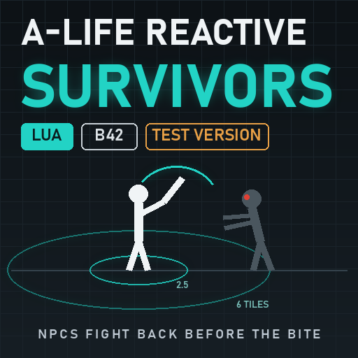

# A-Life: Reactive Survivors [B42] — тестовая версия

Дополнение к [Project A-Life [ALIFE NPCS]](https://steamcommunity.com/sharedfiles/filedetails/?id=3803984183) (автор Vice):
NPC раньше замечают зомби и быстрее отбиваются. Сам Project A-Life не меняется, его код не копируется; это отдельный
мод на Lua, который подстраивает A-Life через его публичные таблицы и функции.

> **Тестовая версия (0.1.0).** В нашей игре работает, но долгой сессии ещё не было, и числа могут поменяться.
> Отзывы — в комментариях Steam или в Issues.

**Мастерская Steam:** https://steamcommunity.com/sharedfiles/filedetails/?id=3829332775 · **Исходный код (MIT):** https://github.com/druidqwerty/ALifeReactiveSurvivors

Мод бесплатный, исходники открыты. Код пишет нейросеть, а с меня — постановка задач, тесты и время. Если мод сделал игру лучше, [поддержите на Boosty](https://boosty.to/lrgpp).

English version: [README.md](README.md)

## Проблема

Зомби идёт прямо на NPC из A-Life 7–10 клеток. NPC смотрит на него, оружие не достаёт, а потом стоит, пока его кусают.
По коду A-Life 1.4.6 причины такие:

- NPC в пути или без дела «обходит» зомби, пока тот не подойдёт на 1,5 клетки, поэтому зомби кусает первым;
- вплотную доставание оружия занимает около 1,2 с, а цикл удара одноручным — около 1,5 с;
- после одного отступления NPC избегает этого зомби 25 с, а после неудачного подхода игнорирует его 10–15 с.

## Что делает дополнение

- **Реагирует до касания.** Зомби в пределах 6 клеток, который идёт на NPC и виден ему, или любой зомби ближе 2,5 клетки —
  и NPC атакует, а не обходит. Отступающие и восстанавливающиеся NPC, режим «избегать зомби» и огневая дисциплина
  A-Life решают как раньше.
- **Дерётся быстрее.** Доставание оружия на 20 % короче; короче подготовка, замах, восстановление и пауза между ударами.
- **Реже залипает.** После отступления избегает зомби 8 с вместо 25; после неудачного подхода игнорирует не дольше 4 с;
  ищет угрозы раз в 150 / 400 / 1200 мс вместо 250 / 1000 / 2500; возвращается в бой при выносливости 50 вместо 72.
- Совместим с Jeem Extension: его фильтр зомби получает те же числа.

Зомби не меняются. В мультиплеере дополнение работает там, где A-Life ведёт NPC (в том числе у игроков).

## Требования и установка

- Project Zomboid Build 42 (42.20+), [Project A-Life [ALIFE NPCS]](https://steamcommunity.com/sharedfiles/filedetails/?id=3803984183).
- Подпишитесь в [мастерской Steam](https://steamcommunity.com/sharedfiles/filedetails/?id=3829332775) и включите
  «A-Life: Reactive Survivors» после Project A-Life. На сервере добавьте `ALifeReactiveSurvivors` в `Mods=` (после
  `ProjectALifeNPCs`) и `3829332775` в `WorkshopItems=`; мод нужен каждому игроку.
- Или без Steam: распакуйте zip из [Releases](https://github.com/druidqwerty/ALifeReactiveSurvivors/releases) в
  `%USERPROFILE%\Zomboid\mods\`, чтобы получилось `mods\ALifeReactiveSurvivors\42\mod.info`.

## Настройки

Все числа — в `42/media/lua/shared/ALifeReactive/00_ALR_Core.lua`, рядом с каждым указано значение A-Life.
Поправьте и перезапустите игру. `enabled = false` выключает дополнение; `draw.scale = 1` возвращает обычную анимацию
доставания оружия.

## Как понять, что работает

- В `console.txt` есть `[ALR] v0.1.0 installed` и `[ALR] tuning re-applied after Decisions.configure`.
- Раз в минуту (если что-то изменилось): `[ALR] checks=.. commits=.. refused=..`. `commits` растёт, когда NPC атаковал
  зомби раньше, чем это сделал бы A-Life.
- Консоль Lua: `ALifeReactive.status()` печатает счётчики и все изменённые значения (было -> стало).

## Известные ограничения

- Тестовая версия: после долгих сессий числа могут поменяться.
- Мультиплеер: укус зомби может считаться в игре другого игрока, а не там, где ведётся NPC, и NPC может не узнать, что
  его кусают. Запланировано на этап 2.
- Оглушение от укуса (0,5 с) и поведение самих зомби не меняются.

## Как это работает (для мододелов)

Решение «что делать с зомби» A-Life принимает в публичной функции `ProjectALife.DecisionLoop.engagement`.
Дополнение оборачивает её и превращает вердикт «bypass / continue_mission» в «commit», когда зомби близко и идёт на
NPC (вердикт «defend» не используется намеренно: боевое состояние «защита в пути» заканчивается на следующем же тике,
как только зомби дальше 1,5 клетки). Срок избегания после отступления, таймеры игнорирования и длительность
доставания оружия ограничены обёртками ещё трёх публичных функций. Тайминги лежат в публичных таблицах настроек
A-Life (`BehaviorSettings`, `Combat.settings`, `Endurance.settings`, полосы цикла решений, ZombieFocus, Fear,
Caution); дополнение записывает туда свои числа и повторяет это после `DecisionLoop.configure`, который пересобирает
таблицы при старте игры. Файлы A-Life не меняются.

## Исходники и тесты

- `42/media/lua/` — мод (4 файла Lua, глобальная таблица `ALifeReactive`).
- `tools/run_test.py` — тест в симуляции с заглушками A-Life (Python + [lupa](https://pypi.org/project/lupa/)):
  `python tools/run_test.py` → `RESULT passed=63 failed=0`.

## Мои моды
- [SmoothRide MP](https://steamcommunity.com/sharedfiles/filedetails/?id=3827367565) — плавные машины в мультиплеере.
- [ZombieSync MP](https://steamcommunity.com/sharedfiles/filedetails/?id=3827946115) — плавные зомби в мультиплеере.
- [Tripping Zombies MP Fix](https://steamcommunity.com/sharedfiles/filedetails/?id=3829034899) — одинаковые падения Tripping Zombies у всех игроков.
- [Wandering Hordes Performance Fix](https://steamcommunity.com/sharedfiles/filedetails/?id=3829140377) — без подвисаний сохранения и лагов клиента из-за Wandering Hordes.
- [Download Unstuck](https://steamcommunity.com/sharedfiles/filedetails/?id=3829163351) — лечит зависание загрузки мастерской при запуске своего сервера.
- **A-Life: Reactive Survivors** — NPC из A-Life отбиваются до укуса (этот мод, тестовая версия).

## Авторы и лицензия

Project A-Life — автор Vice; дополнение работает только вместе с ним. Код дополнения: MIT.
