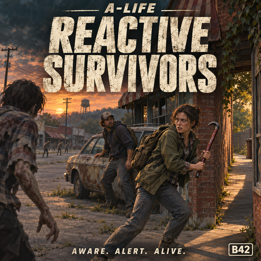

# A-Life: Reactive Survivors [B42]

Мод бесплатный, исходники открыты. Код пишет нейросеть, а с меня — постановка задач, тесты и время. Если мод сделал игру лучше, [поддержите на Boosty](https://boosty.to/lrgpp).

Дополнение к [Project A-Life [ALIFE NPCS]](https://steamcommunity.com/sharedfiles/filedetails/?id=3803984183) (автор Vice):
NPC раньше реагируют на мир вокруг. Они атакуют зомби до укуса, убегают от толпы к своим, уворачиваются от машин и
комментируют происходящее (по-английски и по-русски). Сам Project A-Life не меняется, его код не копируется; это
отдельный мод на Lua, который подстраивает A-Life через его публичные таблицы и функции.

> **0.4.0 — реакция до контакта.** Стоящие и восстанавливающиеся NPC замечают видимых приближающихся зомби: готовые к бою вступают в бой, безоружные и уставшие выбирают короткий проверенный отход. Исправлена отмена только что созданной реакции со стороны A-Life. [Проверки и ограничения](docs/TEST_0.4.0.md).

**Мастерская Steam:** https://steamcommunity.com/sharedfiles/filedetails/?id=3829332775 · **Исходный код (MIT):** https://github.com/druidqwerty/ALifeReactiveSurvivors

English version: [README.md](README.md)

## Проблема

Зомби идёт прямо на NPC из A-Life 7–10 клеток. NPC смотрит на него, оружие не достаёт, а потом стоит, пока его кусают.
По коду A-Life 1.4.6 причины такие:

- NPC в пути или без дела «обходит» зомби, пока тот не подойдёт на 1,5 клетки, поэтому зомби кусает первым;
- вплотную доставание оружия занимает около 1,2 с, а цикл удара одноручным — около 1,5 с;
- после одного отступления NPC избегает этого зомби 25 с, а после неудачного подхода игнорирует его 10–15 с.

А на машины A-Life не смотрит вовсе: выживший на дороге стоит, пока его не собьют.

## Что делает дополнение

Каждая ситуация — лестница: решает первая подходящая ступень, а всё, чего дополнение не касается, остаётся за A-Life.

**Одиночный зомби**

В существующем радиусе реакции (по умолчанию 6 клеток) видимый приближающийся или целящийся в NPC зомби вызывает реакцию до контакта. Готовый вооружённый NPC начинает бой через A-Life. Безоружный, уставший или избегающий зомби может отойти на расстояние до 3 клеток по проверенному пути. Уменьшенный допуск достижения цели не даёт короткому отходу завершиться почти на месте. Без безопасного пути движение не навязывается. Разговоры, приказы, посты охраны, пассажиры и страх стрелка сохраняют приоритет; занятых NPC не заставляют бессмысленно бродить.

**Толпа зомби** (идея из комментариев в Steam)
1. Три и больше зомби в 6 клетках: заранее не атакует. A-Life решает вплотную и отступает при численном перевесе,
   как и раньше.
2. Три и больше в 6 клетках, и хотя бы двое идут на NPC: он оценивает до 11 коротких путей отхода, обычно до 8 клеток.
   Проверяет известных зомби по пути и в конечной точке, препятствия и заборы, огонь, костры, воду, отсутствующий пол
   и незагруженные клетки. Проверяются и опасные срезы по диагонали.
3. Союзник в 20 клетках может повлиять на выбор, но не отменяет проверку безопасности. Отход остаётся снаружи либо
   внутри текущего здания. Без проверенного пути дополнение не навязывает движение: решение остаётся за A-Life.
   Ближних зомби NPC слышит, дальние должны быть видимыми.
4. Не больше трёх таких пробежек в минуту. Охрана на привязи, NPC с приказом и держащие пост никуда не уходят.

**Машина** (слышит, смотреть не обязательно)
1. Медленная машина (до 12 км/ч) едет на стоящего NPC ближе 5 клеток: NPC отходит на 2 клетки («Проезжай.»).
2. Машина быстрее 12 км/ч, чья траектория пройдёт в 2 клетках от NPC в ближайшие 2,2 секунды: NPC спринтом уходит на
   3 клетки вбок, прочь от траектории («Эй, осторожно!»).
3. Быстрее 25 км/ч и меньше секунды до сближения: прыжок на 4,5 клетки («Берегись!»). Игрока, который так сделал, NPC
   запоминает.
4. Всё же сбили: через мгновение после собственного вскрика A-Life — «Ай! Ты меня сбил!»; тот же игрок второй раз за
   две минуты — «Ещё раз, и у нас будут проблемы.»

NPC внутри зданий, в машинах и в бою не уворачиваются.

**Укусили**: «Отвали!» через секунду после укуса.

**Дерётся быстрее, реже залипает** (с 0.1.0): доставание оружия на 20 % короче; короче подготовка, замах,
восстановление и пауза между ударами; после отступления избегает зомби 8 с вместо 25; после неудачного подхода
игнорирует не дольше 4 с; чаще ищет угрозы; возвращается в бой при выносливости 50 вместо 72. Совместим с Jeem
Extension (его фильтр зомби получает те же числа).

Все реплики есть на английском и русском; NPC говорит на языке той игры, которая его ведёт. Зомби не меняются.
В мультиплеере дополнение работает там, где A-Life ведёт NPC (у игроков), поэтому нужно всем игрокам.

## Требования и установка

- [ZombieBuddy](https://steamcommunity.com/sharedfiles/filedetails/?id=3619862853) должен быть установлен по требованиям A-Life. [Jeem Extension](https://steamcommunity.com/sharedfiles/filedetails/?id=3806944055) — опционально, но для полноценного опыта рекомендуется; интеграция настроек не является жёсткой зависимостью mod.info.
- Project Zomboid Build 42 (42.20+), [Project A-Life [ALIFE NPCS]](https://steamcommunity.com/sharedfiles/filedetails/?id=3803984183).
- Подпишитесь в [мастерской Steam](https://steamcommunity.com/sharedfiles/filedetails/?id=3829332775) и включите
  «A-Life: Reactive Survivors» после Project A-Life. На сервере добавьте `ALifeReactiveSurvivors` в `Mods=` (после
  `ProjectALifeNPCs`) и `3829332775` в `WorkshopItems=`; мод нужен каждому игроку.
- Или без Steam: распакуйте zip из [Releases](https://github.com/druidqwerty/ALifeReactiveSurvivors/releases) в
  `%USERPROFILE%\Zomboid\mods\`, чтобы получилось `mods\ALifeReactiveSurvivors\42\mod.info`.

## Настройки

Все 66 настроек — общие параметры мира/сервера Sandbox на странице **A-Life: Reactive Survivors**. Они задаются
при хостинге; администратор может изменить Sandbox работающего мира. Применяются в течение двух секунд без
перезапуска и не дублируются в личных ModOptions. Старые сохранения получают значения по умолчанию для новых опций.
**Безопасный отход от толпы** включён по умолчанию; отключение возвращает прежний геометрический выбор направления.
Главный переключатель работает на ходу и восстанавливает параметры A-Life, которые дополнение ещё контролирует.

## Как понять, что работает

- В `console.txt` есть `[ALR] v0.4.0 installed`.
- Раз в минуту (если что-то изменилось): `[ALR] checks=.. commits=.. dodges=.. dives=.. fallbacks=.. regroups=..
  bites=.. hits=.. lines=..`. `commits` растёт, когда NPC атаковал зомби раньше, чем A-Life; `dodges` / `dives` —
  когда отпрыгнул от машины; `fallbacks` / `regroups` — когда убежал от толпы.
- Консоль Lua: `ALifeReactive.status()` печатает счётчики и все изменённые значения (было -> стало).

## Известные ограничения

- Если A-Life не передал физического NPC клиенту-владельцу, аддону нечем управлять. В одном тесте после гибели предыдущих NPC возникли `replica_missing` и сбой восстановления тела со стороны A-Life; его подсистема репликации этим релизом не исправляется.

- Это локальный отход, не глобальный навигатор и не гарантия спасения. При исчерпании бюджета поиска решение остаётся
  за A-Life. Порог толпы, решения в бою, охрана постов и приказы в этом этапе не меняются.
- Новый алгоритм не меняет пути уворотов от машин. Передача NPC между игроками в MP и длительная игра с большими
  сборками ещё требуют более широкого покрытия; симуляция этого не доказывает.
- В бою NPC от машин не уворачивается; учитываются только машины на этаже NPC.
- Мультиплеер: укус зомби может считаться в игре другого игрока, а не там, где ведётся NPC, и NPC может не узнать, что
  его кусают. Запланировано на следующие версии.
- Оглушение от укуса (0,5 с) и поведение самих зомби не меняются.

## Как это работает (для мододелов)

Решение «что делать с зомби» A-Life принимает в публичной функции `ProjectALife.DecisionLoop.engagement`.
Дополнение оборачивает её и превращает вердикт «bypass / continue_mission» в «commit», когда зомби близко и идёт на
NPC (вердикт «defend» не используется намеренно: боевое состояние «защита в пути» заканчивается на следующем же тике,
как только зомби дальше 1,5 клетки). Срок избегания после отступления, таймеры игнорирования и длительность
доставания оружия ограничены обёртками ещё трёх публичных функций. Тайминги лежат в публичных таблицах настроек
A-Life (`BehaviorSettings`, `Combat.settings`, `Endurance.settings`, полосы цикла решений, ZombieFocus, Fear,
Caution); дополнение записывает туда свои числа и повторяет это после `DecisionLoop.configure`, который пересобирает
таблицы при старте игры.

Лестницы толпы и машин висят на `ModuleGunFear.interrupt` — хуке, который цикл решений вызывает на каждом «думании»
стоящего, идущего, обыскивающего или восстанавливающегося NPC, передавая свои помощники `startMovement` /
`startRetreat`; наши намерения движения записаны в `Decisions.panicHolds`, поэтому цикл не трогает уворот, пока тот не
закончится. Машины берутся из `getCell():getVehicles()`, скорость — из двух замеров позиции (первый замер: вектор
направления на показания спидометра). Зомби — из собственного снимка A-Life (`Perception.snapshotFor`) через его
16-клеточные корзины. Реплики идут через `Speech.say` A-Life (тот же пузырь, то же зеркалирование в мультиплеере);
болевые — через `Speech.display`, потому что только что сбитого NPC A-Life держит молчаливым пять секунд. Файлы A-Life
не меняются.

## Исходники и тесты

- `42/media/lua/` — мод (глобальная таблица `ALifeReactive`).
- `tools/run_test.py` — тесты в симуляции с заглушками A-Life (Python + [lupa](https://pypi.org/project/lupa/)):
  `python tools/run_test.py` → 743 проверки (в том числе 41 проверка осведомлённости, передачи действия и загрузки),
  плюс проверка переводов реплик EN/RU.
- `tools/ALR_AwarenessLive.lua` и `tools/ALR_AwarenessMP*.lua` — игровые наблюдатели SP/двух клиентов для изолированных тестовых миров; не входят в исполняемый код мода.
- [Объём и результаты проверки 0.4.0](docs/TEST_0.4.0.md).
- `tools/make_art.py` — постер, иконка и превью.

## История версий

- **0.4.0** (01.11.2026): ранняя реакция стоящих NPC, проверенный короткий отход, передача действия без немедленной отмены движения ALR; исключение тел/NPC из угроз и повторная попытка загрузки после временной ошибки.

- **0.3.0** (31.10.2026): проверенный локальный путь отхода от толпы; без непроверенного резервного движения;
  все настройки в глобальном Sandbox с применением на ходу, обратимое изменение параметров, переводы EN/RU.
- **0.2.1** (31.10.2026): исправлено сканирование машин в Build 42.21 — `IsoCell.getVehicles()` возвращает Java Set,
  поэтому мод использует итератор вместо несуществующего `get(index)`. Повторяющиеся ошибки
  `ALR_Vehicles.lua — Object tried to call nil` устранены.
- **0.2.0** (29.10.2026, тестовая версия, Steam + GitHub): лестницы для толпы зомби и для машин, безоружные
  NPC не лезут в бой, реплики на английском и русском, реакции на укус и на наезд; настройки переехали в
  `01_ALR_Settings.lua`.
- **0.1.0** (29.10.2026, Steam + GitHub): атака приближающегося зомби до касания, быстрее доставание и удары, короче
  таймеры избегания и игнорирования.

## Мои моды
- [SmoothRide MP](https://steamcommunity.com/sharedfiles/filedetails/?id=3827367565) — плавные машины в мультиплеере.
- [ZombieSync MP](https://steamcommunity.com/sharedfiles/filedetails/?id=3827946115) — плавные зомби в мультиплеере.
- [Tripping Zombies MP Fix](https://steamcommunity.com/sharedfiles/filedetails/?id=3829034899) — одинаковые падения Tripping Zombies у всех игроков.
- [Wandering Hordes Performance Fix](https://steamcommunity.com/sharedfiles/filedetails/?id=3829140377) — без подвисаний сохранения и лагов клиента из-за Wandering Hordes.
- [Download Unstuck](https://steamcommunity.com/sharedfiles/filedetails/?id=3829163351) — лечит зависание загрузки мастерской при запуске своего сервера.
- [A-Life: Caravans](https://steamcommunity.com/sharedfiles/filedetails/?id=3829571361) — караваны фракций и встречи на дорогах.
- **A-Life: Reactive Survivors** — NPC из A-Life отбиваются до укуса (этот мод).

## Авторы и лицензия

Project A-Life — автор Vice; дополнение работает только вместе с ним. Лестница толпы — по предложению Simplement_Ra
из комментариев в Steam. Код дополнения: MIT.
